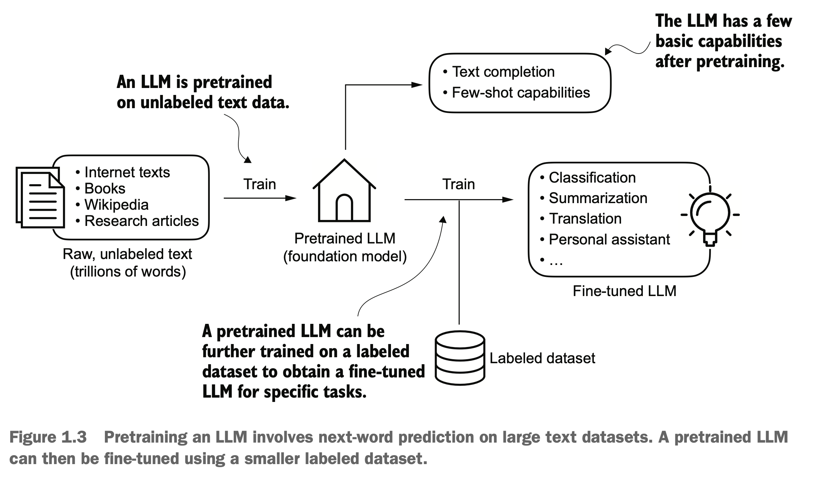
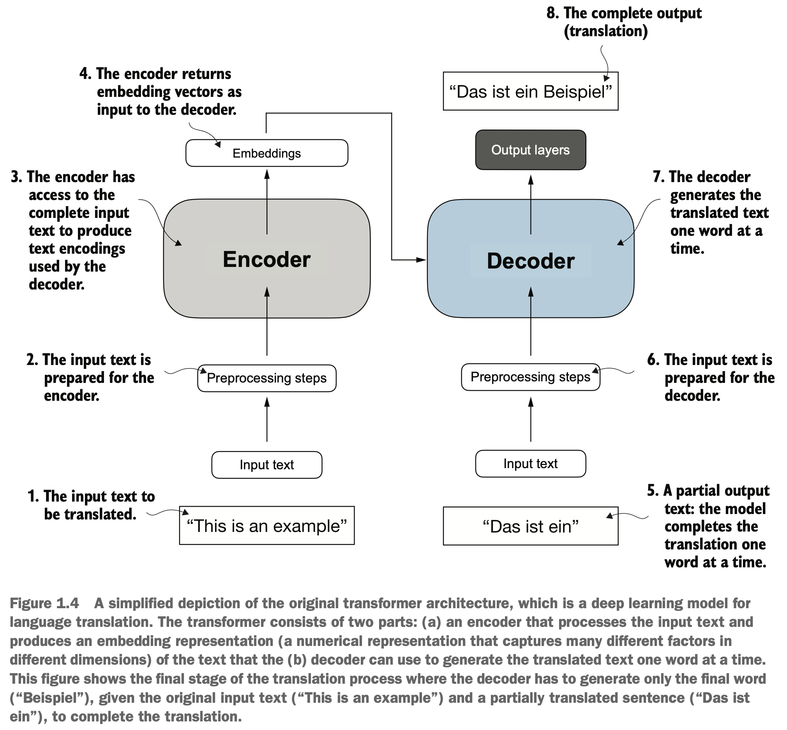
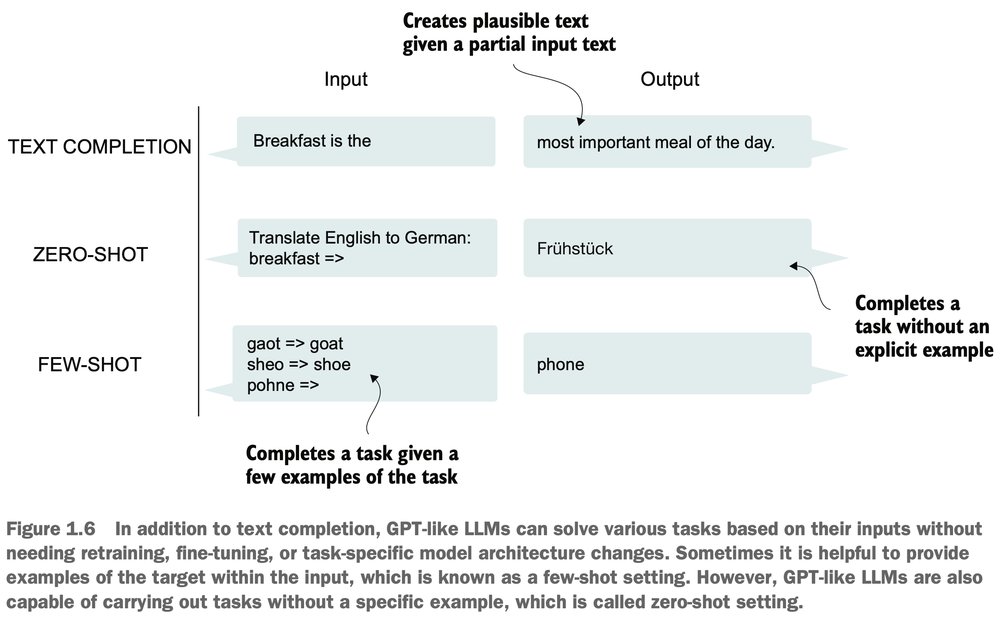
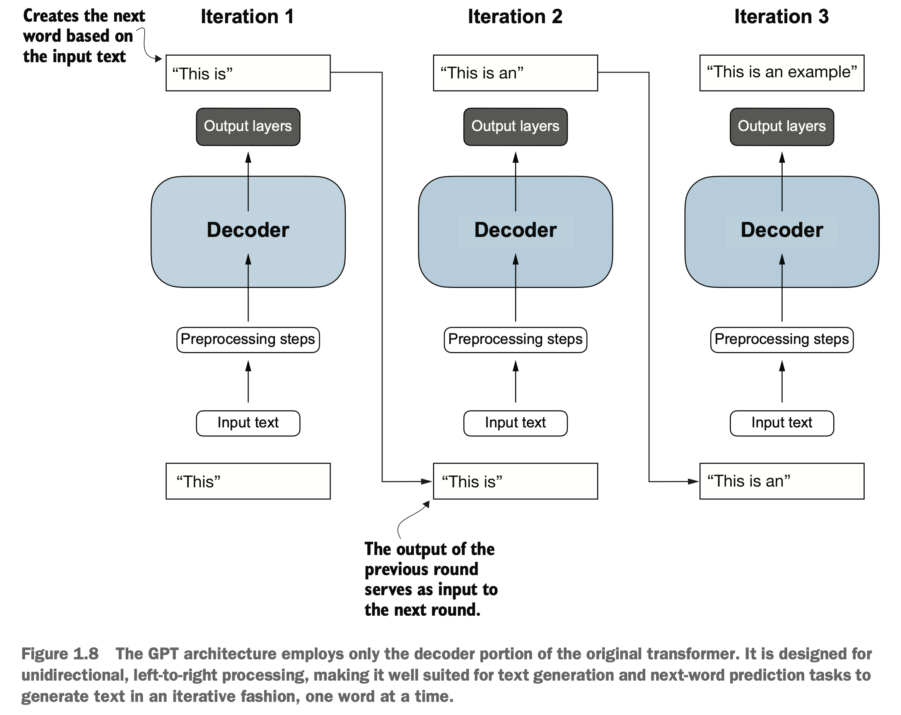
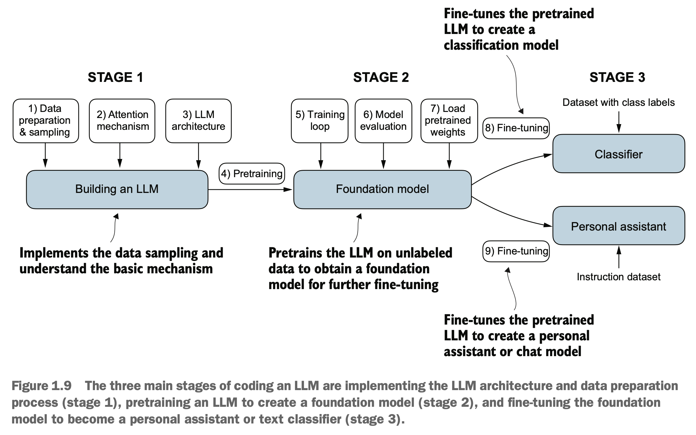

# Building a LLM from scratch : Sebastian Raschka

## 0. Introduction
- A foundation model is a model that is trained on a large amount of data and it performs reasonably well on various different tasks but it isn't specialized for a particular application. We can perform fine-tuning on this model, thus, giving it "expertise" in a particular task, where it can perform exceptionally well, i.e., classification, chatbot, etc.

## 1. Understanding LLMs
- An LLM is a neural network designed to understand, generate and respond to human-like text. These NN are trained on large amount of text data.
- The parameters of these models are optimized to predict the next word in the sequence, which exploits the inherent sequential nature of language to understand the context, structure and relationship within text.
- LLMs use the transformer architecture which allows them to pay attention to various parts of the sentence to predict the next word. This ability to pay attention enables transformers to handle nuances and complexities embedded within human language.
- Pretraining an LLM means training the model on a large, diverse and general dataset to develop a broad understanding of language, which makes the LLM foundational. After pretraining, the model can be trained on a narrower dataset for a particular task, which is called fine-tuning. This approach made up of pretraining and fine-tuning is shown below:

- A pretrained LLM (foundation model) can have few-shot capabilities, which means it can perform new tasks based on only a few examples, instead of needing extensive training data.
- The pretraining is done in a self-supervised manner, where the model learns to predict the next word. When we want a specific objective, we can fine-tune the model, which means training it on labeled data, specific to the objective.
- Two most popular fine tuning categories are instruction and classification. 
- In instruction fine tuning, the labeled dataset contains instruction and answer pairs, eg., a query to translate a text and the correctly translated text.
- In classification fine tuning, the labeled dataset contains texts and associated class labels, eg., an email and a spam label.
- At the heart of an LLM sits the transformer architecture, which is shown below:

- The transformer consists of two integral parts, an encoder and a decoder.
- The encoder converts the input information into a numerical representations or vectors that contain the contextual information of the input.
- The decoder takes the vectors and coverts them back to text.
- For example, in a translation task, the encoder can convert english text into a latent representation (aka vector) and the decoder can decode these vectors to generate text in german.
- Both the encoder and decoder contains many layers connected by an attention mechanism. The self-attention mechanism allows the model to rank the importance of different words (aka tokens) in a sequence to each other. This mechanism enables the model to capture long-range dependencies and contextual relationships in the input data, enhancing the model's capability to generate coherent and contextually relevant output.
- **NOTE:** GPT like models are great at zero-shot and few-shot learning tasks. Zero-shot learning refers to the ability to generalize to completely unseen tasks without any prior training, while, few-shot learning refers to the ability to learn from a small examples.

- GPT like models use only he decoder to generate text by predicting one word at a time, and are called auto-regressive. An autoregressive model incorporate its previous outputs as inputs for the next prediction. This auto-regressive nature improves the coherence of the resulting text. This property is shown in the following image:

- **NOTE:** GPT like models consisting of only the decoder block were aimed at next word prediction, can perform translation as well which wasn't the intended outcome. This ability to perform task that the model wasn't trained for is called an emergent behavior which is a consequence of the fact that it had exposure to vast multilingual data in diverse contexts. The model learns the translation patterns between languages and can perform translation. This means, that we can perform a variety of tasks with a single model instead of training one model for each task.
- The LLM can be built in three stages: 

