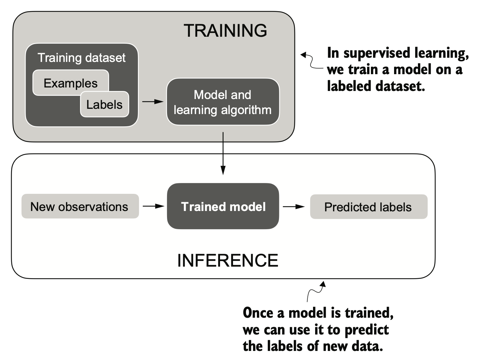

# Introduction to PyTorch
It is a open source python-based DL library which is quite flexible and user-friendly.

## The three core components of PyTorch
1. Tensor library: a fundamental building block for efficient computing with the option to use GPUs for faster computations
2. Automatic differentiation engine or Autograd: utilities to automatically compute gradients for tensor operations, simplifying backpropagation and model optimization
3. DL library: utility functions that make it easier to implement and train deep neural networks.

## What is deep learning
- AI is concerned with creating computer systems that can perform tasks that require human intelligence. 
- ML is a sub-field of AI that focuses on developing algorithms by which the a machine can learn. The idea behind this is to allow machines to learn from available data, make predictions or decisions without being told to do so.
- DL is a sub-field of ML which focuses on learning algorithms inspired by the human brain (using deep "neural" networks). The "deep" here means the use of many hidden layers of neurons that allow the model to learn complex and non-linear relationships. 
- Typical supervised-learning setup looks like the following picture: 

